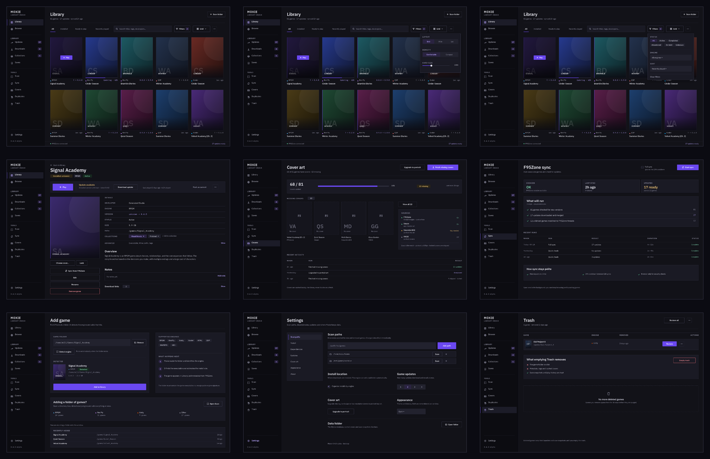

# Moxie Desktop — Launcher Benchmark & Polish Review

**Date:** 2026-11-07 · **Scope:** desktop frontend (`desktop/frontend`), current `dev` redesign
**Screenshots:** [`screenshots/polish-2026-11/`](screenshots/polish-2026-11/)
**Prototype:** [`design/moxie-polish.figcraft`](../design/moxie-polish.figcraft) · [`design/renders/00-contact-sheet.png`](../design/renders/00-contact-sheet.png) · [`design/moxie-polish.pdf`](../design/moxie-polish.pdf) — nine screens implementing the P0/P1 direction.
**Implementation status:** library P0-1/P0-2/P0-3 are in `desktop/frontend` (header + count/sync, 11px caption tokens, neutral engine tags with aligned dots, and a one-row toolbar with View/Filters popovers). Implemented-state captures: `screenshots/polish-2026-11/impl/`. P0-4 (Covers/Sync/Add game/Settings) remains.
**Companion:** the original research and pre-redesign audit live in [`desktop-ui-research.md`](desktop-ui-research.md). This document reviews the *current* build and benchmarks it against 2026 launchers.

---

## 0. TL;DR

Moxie no longer looks like a database admin tool. The library is a real cover grid with three presentations, quick play-state views, play affordances, and a coherent typographic identity. On the primary surface it now sits comfortably beside Heroic and Playnite.

The remaining polish gap is concentrated in two places:

1. **Micro-legibility** — 10px metadata at 3.0:1 contrast, and 7 of 15 engine colours below 4.5:1 on the dark ground.
2. **The ring of secondary screens** — Covers, Sync, Add Game, Settings and Trash are still form-first or empty-first, while every mature launcher makes its management screens *action-first*.

**Scorecard (1–5, qualitative):**

| | Visual clarity | Intuitive UI/UX | Easy-to-follow layout |
|---|---|---|---|
| Steam (2026) | 4.5 | 4.0 | 4.0 |
| itch.io app | 4.0 | 4.5 | 4.5 |
| Heroic 2.22 | 3.5 | 3.5 | 4.0 |
| Playnite 10.63 | 3.0 | 4.0 | 3.5 |
| Lutris 0.5.22 | 2.5 | 3.0 | 3.0 |
| GOG Galaxy 2.0 | 4.0 | 2.5 | 3.0 |
| Epic Games Launcher | 3.5 | 2.0 | 2.5 |
| **Moxie (current)** | **3.5** | **3.5** | **3.5** |
| **Moxie (target after P0)** | **4.5** | **4.5** | **4.5** |

Moxie's ceiling is higher than its current score because the design system, grid, and keyboard model are already in place. The P0 items are a legibility pass and a secondary-screen layout pass — not a redesign.



---

## 1. Method

- Ran the desktop frontend standalone in Chromium through the dev-only mock Wails runtime (`desktop/frontend/mock/`, `vite.mock.config.js`, `/mock.html`), the same harness described in `desktop-ui-research.md §5.1`.
- Captured at **1440×900** (baseline), plus **1200×800**, **1920×1080**, and **2560×1440**, dark scheme. Screenshots are committed under `docs/screenshots/polish-2026-11/`.
- Measured computed styles and geometry from the DOM (font size, contrast ratio against the effective background, control hit areas, pane widths, row/card heights).
- Cross-checked every claim against source. The mock's covers are generated gradients, so **this review judges layout, type, colour, and interaction — not the quality of real cover art**.
- Reviewed current reference builds: Steam 2026 client (incl. the September 2026 "Big Art Mode" beta), Playnite 10.63 (2026-10-19), Heroic 2.22.4 (2026-10-15), Lutris 0.5.22, itch.io app, GOG Galaxy 2.0, Epic Games Launcher. Sources in §8.

---

## 2. What Moxie does well now

These are not consolation prizes; they are the reasons the remaining list is short.

1. **The library is a collection, not a table.** Grid, Wide (16:9 landscape), and List share one dataset; Compact density and a Size slider persist. This is more presentation control than Steam offers and equivalent to Heroic/Playnite.
2. **Titles are always visible under the art.** Steam and Heroic both make you infer a game from its capsule; Moxie's plaintext title is a direct usability win.
3. **Play is present on all three surfaces** — hover/focus on grid cards, a dedicated row action in List, and a primary button in Detail.
4. **Quick views encode play-state** (`All / Installed / Ready to play / Recently played`) instead of making status the only axis. The curation status chips remain available as a second axis.
5. **The detail page is structurally right:** large art + title, metadata table, stacked Overview/Notes/Downloads/Play history, a sticky action column with Play first.
6. **Collections are real objects:** cover collages, members, and smart collections by engine/status.
7. **Duplicates is genuinely good:** side-by-side copies with path, size, and Keep/Remove — clearer than most launchers.
8. **Keyboard parity is strong:** `/` and `Ctrl/⌘+F` focus search (`App.svelte:749`), roving-tabindex arrow navigation, visible focus ring, keyboard context menu.
9. **The visual system has a voice.** IBM Plex Sans Condensed for labels, Plex Mono for numerics, square tags, hairlines instead of shadows, one violet accent, no emoji. It reads as a designed catalogue rather than a framework default.

---

## 3. Where the polish gap is

### 3.1 Measured legibility

Contrast measured against `--bg-primary: #121218` (dark theme).

| Element | Size | Colour | Contrast | Verdict |
|---|---|---|---|---|
| Card title | 14px / 500 | `--text-primary` #e0e0e8 | **14.2:1** | Pass |
| Search input | 13px | `--text-primary` | 14.2:1 | Pass |
| Status chips | 11px | `--text-secondary` #9090a0 | **5.5:1** | Pass |
| Card version / recency | **10px** | `--text-muted` #606070 | **3.0:1** | **Fail (AA small text)** |
| Card engine tag | **10px** | engine colour, e.g. RPGM #0b79d1 | **4.15:1** | **Fail** |
| Active quick tab | 12px / 600 | white on `--accent` #7c5cfc | **4.38:1** | **Marginal fail** |
| Demoted sidebar items | 12px | `--text-muted` | **3.0:1** | **Fail** |

Engine tag palette audit (`internal/engine/engine-colors.json` vs `#121218`):

| Pass ≥ 4.5 | Fail < 4.5 |
|---|---|
| Godot 7.10 · Java 6.61 · WebGL 5.90 · Others 5.72 · RAGS 5.39 · Unity 5.07 | **Unreal Engine 2.16** · **Flash 3.01** · **QSP 3.75** · **RenPy 3.93** · **WolfRPG 4.03** · **HTML 4.05** · **RPGM 4.15** |

Seven of fifteen engine colours — including the three most common in this library (RenPy, RPGM, HTML) — are below AA for 10px text. The tags are meant to aid scanning; at this size and contrast they are decoration.

**Screenshot evidence:** [`01-library-grid.png`](screenshots/polish-2026-11/01-library-grid.png) — the version/recency line under each cover is barely visible at normal viewing distance.

### 3.2 The library toolbar is a control wall

At 1440×900 the content begins at y=85 because the library stacks two full-width bars:

- **Quick bar (39px):** 4 quick tabs + Grid/Wide/List + Comfortable/Compact + Size slider.
- **Filter bar (46px):** search + engine select + arrangement select + 6 status chips (All + 5 statuses).

That is **19 interactive targets before the first cover**, with three different "All" concepts (quick view, engine, status) and no label separating "play state" from "curation status". Heroic uses one toolbar plus a left rail; Steam uses one filter row. Hick's law applies: every extra control raises the cost of choosing one.

**Screenshots:** [`01-library-grid.png`](screenshots/polish-2026-11/01-library-grid.png), [`07-library-1200.png`](screenshots/polish-2026-11/07-library-1200.png) (at 1200px the Size slider is flush to the window edge).

### 3.3 Page hierarchy is inconsistent

Library and Browse begin with controls. Updates, Downloads, Collections, Saves, Settings, Trash, Covers, Sync and Scan begin with an `<h1>` + subtitle. There is no shared header component and no count/summary on the library. The result is that the library feels like a canvas while every other view feels like a settings page — the exact split the redesign was meant to remove.

### 3.4 Secondary screens are form-first and mostly empty

| View | What it is now | Why it costs usability |
|---|---|---|
| **Covers** [`16-covers.png`](screenshots/polish-2026-11/16-covers.png) | Two explanatory paragraphs, two buttons, ~75% blank space | No coverage count, no missing-cover preview, no progress region. It reads as documentation for a CLI command. |
| **Sync** [`17-sync.png`](screenshots/polish-2026-11/17-sync.png) | Full-width green "cookies available" banner + a checkbox + a 93×32 "Start Sync" button | The status banner is the loudest element; the primary action is the smallest. No last-synced time, scope, plan, or history. |
| **Add Game** [`22-add-game.png`](screenshots/polish-2026-11/22-add-game.png) | One input stretched ~1,060px, Browse detached at the far right, a muted "Detect Engine" button | The eye travels the whole window for a two-field task. Nothing tells you what happens next. |
| **Settings** [`21-settings.png`](screenshots/polish-2026-11/21-settings.png) | One ~1,140px column; 80–100px of dead space between section rules; two-column only at ≥1600px | At the common 1440p window half the page is empty and sections are far apart. |
| **Trash** [`20-trash.png`](screenshots/polish-2026-11/20-trash.png) | A red **Purge All (1)** button is the only prominent control | The most dangerous action has the highest emphasis; Restore is visually weak. |
| **Downloads** [`13-downloads.png`](screenshots/polish-2026-11/13-downloads.png) | Stats bar + search + one collapsed row | Microcopy is unpluralised ("1 games with links", "1 dead links"); the body is mostly empty. |

### 3.5 The detail page has two competing focal points

[`09-detail.png`](screenshots/polish-2026-11/09-detail.png)

The title row carries `Installed: unknown`, `Download Update` (accent outline) and `Mark as current`. Play lives in the left action stack, below a large cover. At 1440 the eye lands on the title/update row first and must travel down-left to the action the app exists for. Steam and itch put Play in a bar directly under the title; the management actions are secondary.

The metadata block is also form-shaped: every label is 11px uppercase condensed at `--text-muted`, so Developer, Engine, Version, Status, Executable, Wine prefix, Size, Path, Collections, Tags and F95Zone all have equal weight.

### 3.6 The edit dialog can hide its own Save button

`EditGameDialog.svelte:239` sets `max-height: 88vh; overflow-y: auto` on the dialog content, and the Cancel/Save footer is at line 401 — inside the scroll content, not sticky. At 900px viewport height the dialog is clipped ([`11-edit-dialog.png`](screenshots/polish-2026-11/11-edit-dialog.png)) and the footer is below the fold. A user who changes one field must scroll past the entire form to commit it.

### 3.7 Sidebar hides six destinations, including Settings

Library/Browse are 16px/600; the next tier (Updates/Downloads/Collections/Saves) is uppercase 14px; Scan/Sync/Covers/Duplicates/Trash/Settings sit behind a collapsed, 11px muted "› Manage" disclosure. Settings is a frequent destination and should not require discovering a disclosure. There are also no icons, which makes the rail scan as a text index rather than a launcher.

### 3.8 Microcopy still has developer voice

- Status bar: `v0.4.0-alpha` persistent, `Library ready` (`StatusBar.svelte`).
- Counts: "1 games with links", "1 dead links" (`DownloadsView.svelte:168`).
- No "Clear search" action in the no-results state ([`06-search-empty.png`](screenshots/polish-2026-11/06-search-empty.png)), despite good copy.

### 3.9 Responsive behaviour: grid good, forms weak

The grid is genuinely responsive: 4 columns at 1200, 5 at 1440, 8 at 2560; cards scale with the container and the Size slider ([`07-library-1200.png`](screenshots/polish-2026-11/07-library-1200.png), [`08-library-2560.png`](screenshots/polish-2026-11/08-library-2560.png)). But forms and single-action views stretch to full width at every size, so a 1-field form looks emptier the larger the window gets.

---

## 4. The launcher benchmark

### 4.1 Steam — the mass-market baseline

**Look.** Blue-black chrome; a narrow left icon rail (Store/Library/Community/Profile); a library home built from horizontal shelves of wide capsule art; a game page with a full-bleed hero, logo, and a play bar directly under the title; a portrait grid for "all games"; a What's New shelf; a downloads page.

**Behaviour.** Recency-first home, custom shelves, dynamic collections (tag/filter-driven), drag-and-drop into collections, a play bar that switches to Stop while running, per-game update/event feeds, and a dense "Small Mode" escape hatch. The 2026 beta adds an art-forward "Big Art Mode" home for Big Picture.

**What to borrow.**
- Play bar under the title, with update/install state in the same row.
- A recency shelf or "Continue playing" row at the top of the library.
- Dynamic collections (Moxie already has smart collections — surface them as first-class).

**What not to copy.** Un-hideable shelves that read as ads, art-only tiles with no names, the loss of a dense list view, and grids that stutter while I/O runs.

### 4.2 Playnite 10.63 — the power-user analogue

**Look.** Windows-native dark navy; a dense top toolbar of ~18 icon buttons; a left icon rail; cover grid with a right-hand details panel; a classic tree-and-form settings window; separate fullscreen themes (PS5/Xbox/Netflix-like).

**Behaviour.** Unified library across stores and emulators; Explorer/filter panel; Details/Grid/List views; controller-first fullscreen; themes and extensions; heavy first-run setup.

**What to borrow.**
- Details *beside* the grid rather than only behind a click.
- The three view modes (Moxie has them).
- Fullscreen/couch mode as a later differentiator.

**What not to copy.** Icon-only toolbars with no labels, the dated default skin, and setup complexity that makes the first run feel like configuration.

### 4.3 Heroic 2.22.4 — the closest analogue

**Look.** Dark; slim left sidebar with icon + label groups (Library, Stores, Settings, Log, Wine Manager); top search + game count + filter chips; a six-column portrait grid with platform badges and small per-tile action icons; a downloads page with queue/progress.

**Behaviour.** Grid + list toggle, recently played strip, per-tile download progress, Play on every card, `/` to focus search, A–Z installed-first, per-store filters.

**What to borrow.**
- Header line: `All Games 141` + Installed chip + search — the count is part of the chrome.
- Sidebar grouping with icons; it makes ten destinations scannable.
- Per-tile play-state badge/progress (Moxie has update edges and "Not installed" — extend to downloading/queued).

**What not to copy.** Tiny unlabeled icon clusters on each tile, and the known list-view polish gap. Moxie's always-visible titles and dedicated List view are already better.

### 4.4 Lutris 0.5.22 — the Linux runner manager

**Look.** Dark grey; left sidebar with Games/Recent/Favourites/Missing and a Sources list (Steam, GOG, Epic, Humble, Ubisoft, …); cover grid with titles underneath; a **bottom inspector bar** showing the selected game, Play, platform, last played and time played.

**Behaviour.** Runner/Wine-centric; source filters; configuration dialogs; a "Missing" view for titles whose install disappeared.

**What to borrow.**
- The bottom inspector: selecting a cover reveals Play + last played + play time without leaving the grid. This is a strong pattern for Moxie's wide window.
- "Missing" as a first-class quick view (Moxie has virtual/not-installed; make it explicit).

**What not to copy.** Config-first flows and the dated visual layer.

### 4.5 itch.io app — the clearest information architecture

**Look.** Near-black; a wide left sidebar with search, Explore/Library/Collections/My creations, a large recently-played tile, and Downloads/Preferences at the bottom; the content pane is a full game page with hero art; a bottom action bar with the install/launch button.

**Behaviour.** Browse and library in one window; install → Play state switching; collections; download queue; acquired-date metadata.

**What to borrow.**
- One obvious primary action per game, in a persistent bar.
- Sidebar labels + icons + a recent tile; it answers "what is this app and what did I play last" instantly.
- State-switching button (Install → Play → Update) rather than separate verbs on separate screens.

**What not to copy.** Mixing store discovery into the library surface. Moxie's separate Browse is the right call.

### 4.6 GOG Galaxy 2.0 — the cautionary showpiece

**Look.** Dark; left rail; a "Recent" home of widgets; imagery-first detail pages with a banner that occupies half the screen; integrated friends/chat.

**Behaviour.** Cross-store integrations, collections, playtime; visually ambitious but operationally fragile, still labelled Beta years after launch.

**What to borrow.** Recency as the landing view; a cinematic detail header.

**What not to copy.** Integration dependency and abandonment. Polish that is not maintained becomes a liability.

### 4.7 Epic Games Launcher — the performance lesson

**Look.** Dark store-first home; rail; large promotional imagery; library treated as a secondary grid.

**Behaviour.** Network-first interactions; Epic's own VP conceded the launcher was slow because every click called a backend.

**What to borrow.** Surface polish and strong art direction.

**What not to copy.** Store-first hierarchy and per-click network latency. Moxie's local SQLite + async pipeline is an advantage; keep every navigation local-fast.

### 4.8 The launcher grammar (synthesis)

Across the set, the patterns that repeat are:

1. **The collection is the home surface.** Management is reachable, not co-equal.
2. **One primary action per game: Play.** Visible in the grid, the row, and the detail — and it changes state while busy.
3. **Recency is the default lens.** Recently played / continue playing is the strongest "what next" signal.
4. **Art plus plaintext title.** Neither alone is sufficient.
5. **Density control plus a list escape hatch.** Power users need a compact mode; large libraries need a list.
6. **Play-state is per-tile; curation is separate.** Installed/downloading/update badges vs. the user's own status.
7. **Sparse screens teach and point to an action.** Empty/sparse states are a pathway, not a dead end.
8. **Local-fast.** UI never waits on a network round-trip to feel responsive.

---

## 5. Side-by-side

| Concern | Steam | Playnite | Heroic | Lutris | itch | **Moxie** |
|---|---|---|---|---|---|---|
| Library presentation | Shelves + portrait grid + Small Mode | Details/Grid/List + right pane | Grid + list | Grid + bottom inspector | Content pages + library | **Grid/Wide/List + size/density** |
| Default lens | Recently played home | Last played | Installed + recent strip | All games | Recently played tile | **Recently played sort + quick views** |
| Play on primary surface | Play bar on detail; grid rows | Per-game | Every card | Bottom bar | Bottom bar | **Hover/focus card, row, detail** |
| Titles with art | Partial | Yes | No | Yes | Yes | **Always** |
| Per-tile state | Update/friend badges | Yes | Install/play/progress | Runner state | Install/play | **Update edge, "Not installed"; missing progress** |
| Density control | Small Mode | Settings | Grid/list | No | No | **3 views + compact + size** |
| Recency surfaced | Home shelves | Sort/filter | Strip | Last played | Recent tile | **Quick view + sort; no shelf** |
| Management surfaces | Downloads/options | Settings/explorer | Stores/Wine/settings | Config dialogs | Preferences | **Covers/Sync/Scan/Duplicates/Trash** |
| Empty/sparse states | Mixed | Mixed | Functional | Functional | Strong | **Good copy, weak actions** |
| Keyboard | Full mouseless | Gamepad/keyboard | `/` search | Limited | Limited | **`/` + Ctrl+F, arrows, context menu** |
| Visual identity | Strong, mature | Dated default | Clean, dense | Dated | Strong, playful | **Strong, editorial** |

### Where Moxie leads

- **Presentation control.** Three layouts plus density plus a size slider is the richest set in this comparison.
- **Titles always visible.** A direct win over Steam/Heroic grids.
- **Curation + smart collections.** A second axis most launchers do not have.
- **Duplicates flow.** Clearer than any of the reference apps.
- **Keyboard parity.** On par with Steam for the library surface.
- **A distinct visual voice.** More coherent than default Playnite or Lutris.

### Where Moxie trails

- **Secondary screens.** Covers/Sync/Add Game are still shells; the reference set makes them action-first.
- **Micro-legibility.** 10px/3.0:1 metadata is the clearest measurable defect.
- **Header consistency.** No shared page header; library has no count/summary.
- **Destructive hierarchy.** Trash promotes Purge All.
- **Dialog ergonomics.** Save/Cancel can sit below the fold.
- **Play-state coverage.** No downloading/queued badge on the library card; no continue-playing shelf.

---

## 6. Prioritized polish backlog

P0 = changes the feel of the product. P1 = strong usability wins. P2 = polish/expansion.
Each item names the files to touch and an acceptance test.

### P0 — Legibility, hierarchy, and the secondary ring

**P0-1 · Shared page header + library summary**
- New `ViewHeader.svelte` (title, one-line summary, primary-action slot). Use on every view.
- Library summary: `81 games · 17 updates · synced 2h ago`; Updates/Downloads/Trash get counts; Covers gets coverage.
- Files: `App.svelte`, all `*View.svelte`, `GameList.svelte`.
- Acceptance: every view has the same header height and type scale; the library no longer starts with controls; the count is visible above the fold at 1440×900.

**P0-2 · Caption and tag legibility pass**
- Raise card meta from `--text-2xs` (10px) to 11px; use `--text-secondary` for versions/recency; raise the muted token or stop using it for functional text.
- Engine tags: neutral text + a 2px colour rule/dot, or darken the seven failing colours:
  `Unreal #0d47a1 → ~#4a7bd0`, `Flash #616161 → ~#9a9a9a`, `QSP #d32f2f → ~#e06a6a`, `RenPy #9d46e3 → ~#b57bee`, `WolfRPG #39843c → ~#6fb873`, `HTML #54812d → ~#8fb35f`, `RPGM #0b79d1 → ~#4fa3e0` (target ≥4.5 on `#121218`).
- Active quick tab: use dark text on accent or an accent underline; white on `#7c5cfc` is 4.38.
- Files: `GameGridCard.svelte`, `GameWideCard.svelte`, `GameTableRow.svelte`, `app.css`, `internal/engine/engine-colors.json`.
- Acceptance: an automated contrast check over card meta, chips, tabs and demoted nav reports ≥4.5 for text under 18px.

**P0-3 · Collapse the library toolbar**
- Row 1: quick views (left) + a single **View** popover (Grid/Wide/List, Comfortable/Compact, Size) on the right.
- Row 2: search + engine + sort + **Filters (n)** popover containing the status chips.
- Rename/label the axes: "Play state" vs "Status"; remove the duplicate "All" chip.
- Files: `GameList.svelte`, `viewState.svelte.js`.
- Acceptance: ≤9 visible controls at 1440; every control reachable by keyboard; state persists across tabs.

**P0-4 · Rebuild Covers / Sync / Add Game as action-first**
- **Covers:** `Coverage 68/81 · 13 missing` + a grid of missing covers + primary Fetch Missing Covers top-right + progress bar during a run.
- **Sync:** compact status row (cookies, last sync, up-to-date count) + a three-line plan (`81 games · 17 updates · 12 unlinked`) + primary Start Sync top-right + a history list.
- **Add Game:** constrain the form to ~640px, put the path field and Browse in one row, make Detect Engine the primary next step (or auto-detect on blur), and show a detected-game preview card with Add.
- Files: `CoversView.svelte`, `SyncDialog.svelte`, `AddGameDialog.svelte`, `ScanPaths.svelte`.
- Acceptance: each view has a visible primary action and a result/status region above the fold at 1440×900.

### P1 — Flow and hierarchy

**P1-1 · Detail play bar.** Move Play into a full-width bar directly under the title; put Download Update / Mark as current in that bar's secondary slot; keep the left column for cover + management (Sync/Edit/Rename/Remove). Files: `GameDetail.svelte`.

**P1-2 · Trash hierarchy.** Demote Purge All to a secondary/overflow action with an explicit confirmation; make Restore the row's primary; add a proper empty state. Files: `App.svelte` (trash section).

**P1-3 · Dialog ergonomics.** Convert `EditGameDialog` to header + scrollable body + sticky footer; two-column fields above ~700px; collapse advanced fields (Wine prefix, executable, tags) behind "Advanced". File: `EditGameDialog.svelte`.

**P1-4 · Settings layout.** Two columns at ≥1200 (not 1600); sticky section nav; halve the vertical gaps between sections; cap the content width. File: `SettingsView.svelte`.

**P1-5 · Sidebar.** Pin Settings at the bottom (near the version); keep Manage for Scan/Sync/Covers/Duplicates/Trash; add 14–16px line icons; raise demoted-item contrast. File: `Sidebar.svelte`.

**P1-6 · Microcopy.** Pluralise counts (`1 game with links`); replace `Library ready` with a meaningful summary (`81 games · 17 updates · synced 2h ago`); move the alpha version to About. Files: `StatusBar.svelte`, `DownloadsView.svelte`.

**P1-7 · Search no-results.** Add a result count and a `Clear search` button; keep the existing copy. File: `GameList.svelte`.

**P1-8 · Downloads rows.** Ensure the group header always shows the game title + counts, add a real empty state, and align the chevron affordance. File: `DownloadsView.svelte`.

### P2 — Polish and expansion

- **P2-1 Continue playing.** A one-row "Continue playing" strip above the grid (or a pinned first row in Recently played). Data already exists in play history.
- **P2-2 Per-tile play-state badges.** Extend the update edge to downloading/queued/installing, matching Heroic's per-tile progress.
- **P2-3 Drag to collection + bulk select.** Playnite/Steam pattern; Moxie has the collections model.
- **P2-4 Fullscreen/couch mode.** Playnite and Steam Big Picture prove the demand; a later differentiator, not a polish task.
- **P2-5 Shortcut sheet.** `?` opens a sheet listing `/`, `Ctrl/⌘+F`, arrows, Enter, Esc, context menu.
- **P2-6 Light-theme audit.** The token set exists; verify the same contrast thresholds on `#f8f8fc`.

---

## 7. What not to copy

- **Steam's shelf clutter.** Un-removable "What's New" shelves and art-only tiles are the most-cited complaints about the 2020 library. Moxie's titles and list view already avoid this.
- **Heroic's tile icon soup.** Six tiny unlabeled icons per cover look informative and are not.
- **Playnite's toolbar.** Eighteen icon buttons in a row is a puzzle, not a menu.
- **GOG's integration-first architecture.** Fragile integrations and a permanent Beta label erode trust; Moxie's local DB is a strength.
- **Epic's network-first interactions.** Never let a click wait on F95Zone.
- **A store-first hierarchy.** Browse is a destination, not the home; the library must remain the landing surface.

---

## 8. Evidence, screenshots and sources

### Screenshot index (`docs/screenshots/polish-2026-11/`)

| File | State |
|---|---|
| `01-library-grid.png` | Library, grid, 1440×900 |
| `02-library-wide.png` | Wide landscape cards |
| `03-library-list.png` | List/table view with row Play |
| `04-library-compact.png` | Compact density |
| `05-grid-hover.png` | Hover Play affordance |
| `06-search-empty.png` | No-results state |
| `07-library-1200.png` | 1200×800 |
| `08-library-2560.png` | 2560×1440 |
| `09-detail.png` | Game detail |
| `10-detail-lower.png` | Detail lower sections |
| `11-edit-dialog.png` | Edit dialog (footer below fold) |
| `12-updates.png` | Updates table |
| `13-downloads.png` | Downloads |
| `14-browse.png` | F95Zone browser |
| `15-collections.png` | Collections + smart collections |
| `16-covers.png` | Cover Art |
| `17-sync.png` | Sync |
| `18-scan.png` | Scan directories |
| `19-duplicates.png` | Duplicates |
| `20-trash.png` | Trash |
| `21-settings.png` | Settings |
| `22-add-game.png` | Add Game with path filled |
| `23-context-menu.png` | Right-click context menu |
| `24-keyboard-focus.png` | Roving focus + Play |

**Mock limitation:** `Saves` is not stubbed in `mock/mock-runtime.js` (`GetSavesOverview` is missing), so it renders an error in the standalone harness. That is a fixture gap, not an app defect.

### Measurements (1440×900, dark)

| Metric | Value |
|---|---|
| Sidebar width | 248px |
| Quick bar / filter bar height | 39px / 46px |
| Grid card (comfortable) | 226×363px |
| Grid columns at 1200 / 1440 / 2560 | 4 / 5 / 8 |
| Card meta / title | 10px / 14px |
| Status chip | 11px, 22px tall |
| View-toggle button | 12px label, 25px tall |
| Visible interactive controls before content | 19 |

### Sources

**Primary product pages**
- Steam Library update: https://store.steampowered.com/libraryupdate
- Steam 2026 Big Picture "Big Art Mode" beta (Sept 2026): https://shazoo.ru/2026/09/11/190458/valve-obnovila-rezim-big-picture-v-steam-i-dobavila-skrinseiver-s-igrami · https://bugsgames.net/valve-refines-the-living-room-experience-a-deep-dive-into-the-latest-steam-beta-update/
- Playnite desktop mode manual: https://api.playnite.link/docs/manual/gettingStarted/playniteDesktopMode.html
- Playnite 10.63 release: https://github.com/JosefNemec/Playnite/releases/tag/10.63
- Heroic 2.22.4 release: https://github.com/Heroic-Games-Launcher/HeroicGamesLauncher/releases/tag/v2.22.4
- Heroic Flathub listing + current library screenshot: https://flathub.org/apps/com.heroicgameslauncher.hgl
- Lutris 0.5.22 release: https://github.com/lutris/lutris/releases/tag/v0.5.22
- Lutris Flathub listing + main-window screenshot: https://flathub.org/apps/net.lutris.Lutris
- itch app: https://itch.io/app · screenshots `https://static.itch.io/images/app/{gamepage,collections,install}@2x.png`
- GOG Galaxy: https://www.gogalaxy.com/en/
- Epic launcher performance admission: https://gamefromscratch.com/epic-are-finally-fixing-the-awful-epic-game-launcher/

**UX theory / supporting**
- NN/g empty states: https://www.nngroup.com/articles/empty-state-interface-design/
- NN/g progressive disclosure: https://www.nngroup.com/articles/progressive-disclosure/
- NN/g recognition vs recall: https://www.nngroup.com/articles/recognition-and-recall/
- Laws of UX — Hick's law: https://lawsofux.com/hicks-law

**Repo**
- Prior research + pre-redesign audit: `docs/desktop-ui-research.md`
- Engine palette: `internal/engine/engine-colors.json`
- Tokens: `desktop/frontend/src/app.css`
- Harness: `desktop/frontend/mock/`, `vite.mock.config.js`, `mock.html`

### How to reproduce

```bash
cd desktop/frontend
npm ci
npx vite --config vite.mock.config.js --port 5199
# open http://localhost:5199/mock.html at 1440×900 (dark)
```

Then use the sidebar and the Grid/Wide/List, Comfortable/Compact and Size controls. The screenshots in this document were captured headlessly with Chromium against that server.
